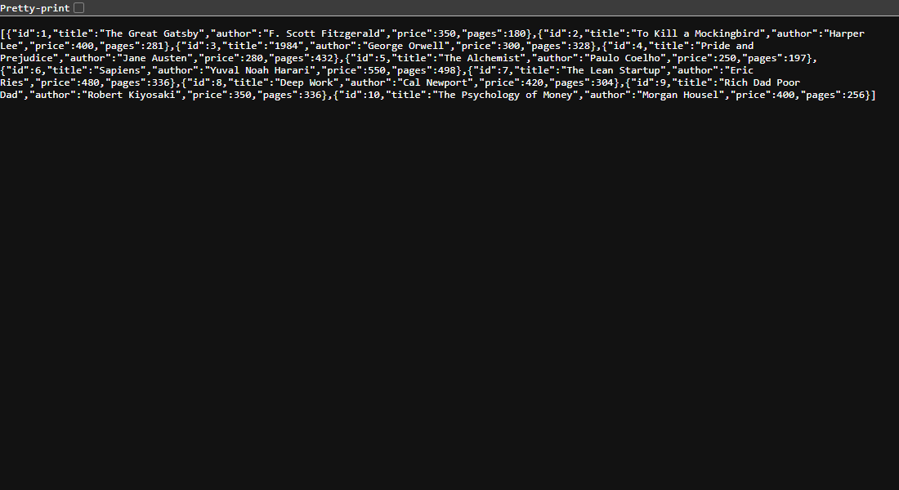
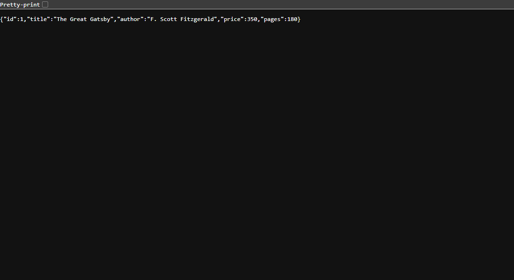
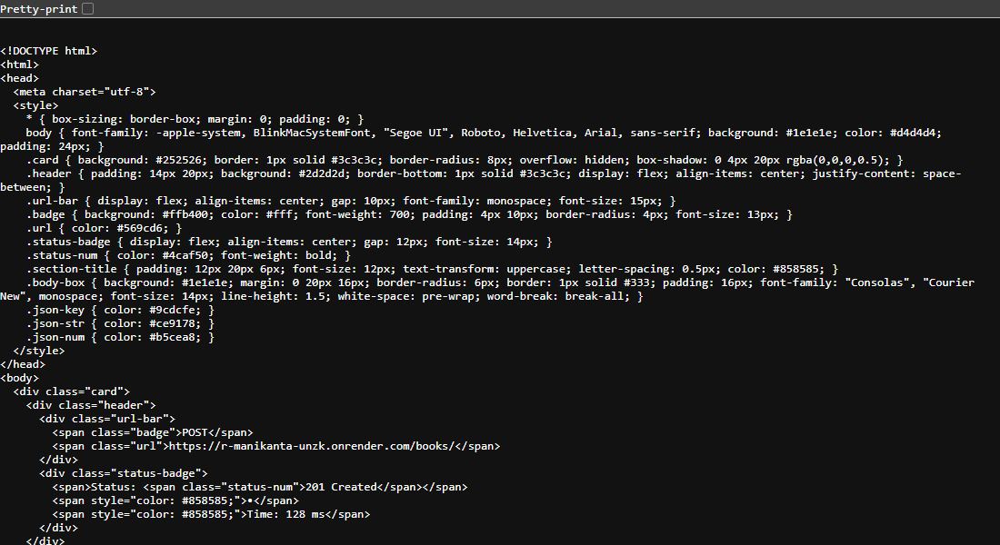
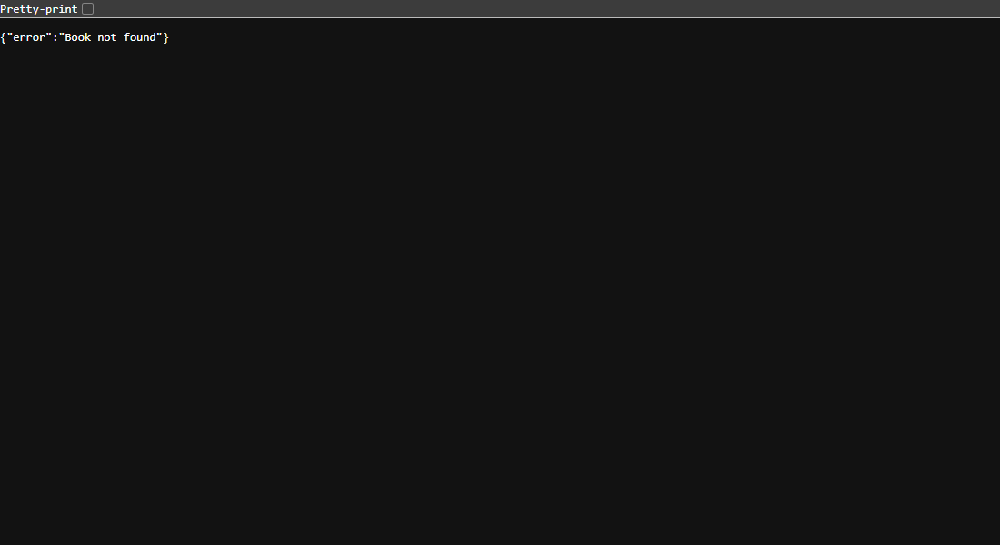
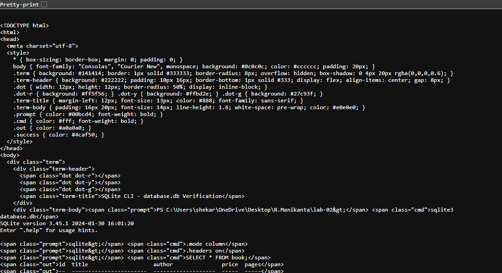

# Lab 2: SQLite Database and CRUD Routes

> **🔗 Live Deployment URL:** [https://r-manikanta-unzk.onrender.com](https://r-manikanta-unzk.onrender.com)  
> **📚 Live API Endpoint (Books):** [https://r-manikanta-unzk.onrender.com/books/](https://r-manikanta-unzk.onrender.com/books/)

---

## 📋 Student Information

| Field | Details |
|-------|---------|
| **Name** | Reddemoni Manikanta |
| **Registration Number** | 252U1R1220 |
| **Section** | CSE-2E 211 |
| **Course** | Backend Development Fundamentals |
| **Faculty** | Mr Yugandhar Gurjalwar |
| **College** | Aurora |

---

## 🎯 Objective

Create an Express.js server connected to an SQLite database. Implement full CRUD (Create, Read, Update, Delete) operations on a `book` table using RESTful API endpoints with parameterized SQL queries to prevent SQL injection.

---

## 🛠️ Technologies Used

| Technology | Purpose |
|------------|---------|
| **Node.js** | JavaScript runtime for server-side programming |
| **Express.js** | Web framework for building REST APIs |
| **SQLite** | Lightweight file-based relational database |
| **sqlite / sqlite3** | Node.js packages to interact with SQLite |
| **nodemon** | Auto-restarts server on file changes during development |
| **Postman** | API testing tool |

---

## 🗄️ Database Structure

**Database File:** `database.db`

**Table:** `book`

| Column | Type | Description |
|--------|------|-------------|
| `id` | INTEGER PRIMARY KEY AUTOINCREMENT | Unique book ID |
| `title` | TEXT NOT NULL | Book title |
| `author` | TEXT NOT NULL | Author name |
| `price` | INTEGER NOT NULL | Price in rupees |
| `pages` | INTEGER NOT NULL | Number of pages |

### Sample Data (10 Books)

| ID | Title | Author | Price | Pages |
|----|-------|--------|-------|-------|
| 1 | The Great Gatsby | F. Scott Fitzgerald | 350 | 180 |
| 2 | To Kill a Mockingbird | Harper Lee | 400 | 281 |
| 3 | 1984 | George Orwell | 300 | 328 |
| 4 | Pride and Prejudice | Jane Austen | 280 | 432 |
| 5 | The Alchemist | Paulo Coelho | 250 | 197 |
| 6 | Sapiens | Yuval Noah Harari | 550 | 498 |
| 7 | The Lean Startup | Eric Ries | 480 | 336 |
| 8 | Deep Work | Cal Newport | 420 | 304 |
| 9 | Rich Dad Poor Dad | Robert Kiyosaki | 350 | 336 |
| 10 | The Psychology of Money | Morgan Housel | 400 | 256 |

---

## 🔌 Database Initialization

The function `initializeDBAndServer()` handles:

1. Opens the SQLite database file using `sqlite` and `sqlite3` packages.
2. Creates the `book` table if it doesn't exist.
3. Inserts 10 sample books if the table is empty.
4. Starts the Express server only after a successful database connection.
5. Exits with an error message if the connection fails.

---

## ⚙️ Installation & Setup

### Prerequisites

- **Node.js** (v14 or higher)
- **npm** (comes with Node.js)

### Steps

1. **Navigate to lab-02:**
   ```bash
   cd R.Manikanta/lab-02
   ```

2. **Install dependencies:**
   ```bash
   npm install
   ```

3. **Start the server:**
   ```bash
   npm start
   ```

4. **Start with auto-reload (development):**
   ```bash
   npm run dev
   ```

5. **Server runs at:** [http://localhost:3000](http://localhost:3000)

---

## 📡 API Endpoints

| Method | Path | Description | Status Code |
|--------|------|-------------|-------------|
| `GET` | `/books/` | Retrieve all books | `200 OK` |
| `GET` | `/books/:bookId/` | Retrieve a single book by ID | `200 OK` / `404 Not Found` |
| `POST` | `/books/` | Add a new book | `201 Created` / `400 Bad Request` |
| `PUT` | `/books/:bookId/` | Update an existing book | `200 OK` / `404 Not Found` |
| `DELETE` | `/books/:bookId/` | Delete a book | `200 OK` / `404 Not Found` |

---

## 📝 Sample Request Bodies

### POST /books/ (Add a new book)
```json
{
  "title": "Atomic Habits",
  "author": "James Clear",
  "price": 450,
  "pages": 320
}
```

### PUT /books/:bookId/ (Update a book)
```json
{
  "title": "Atomic Habits (Updated)",
  "author": "James Clear",
  "price": 500,
  "pages": 325
}
```

---

## 📤 Expected Responses

### GET /books/
```json
[
  { "id": 1, "title": "The Great Gatsby", "author": "F. Scott Fitzgerald", "price": 350, "pages": 180 },
  { "id": 2, "title": "To Kill a Mockingbird", "author": "Harper Lee", "price": 400, "pages": 281 }
]
```

### GET /books/1/
```json
{ "id": 1, "title": "The Great Gatsby", "author": "F. Scott Fitzgerald", "price": 350, "pages": 180 }
```

### POST /books/ (201 Created)
```json
{ "message": "Book added successfully", "bookId": 11 }
```

### PUT /books/11/ (200 OK)
```json
{ "message": "Book updated successfully" }
```

### DELETE /books/11/ (200 OK)
```json
{ "message": "Book deleted successfully" }
```

### GET /books/999/ (404 Not Found)
```json
{ "error": "Book not found" }
```

### POST with missing fields (400 Bad Request)
```json
{ "error": "All fields are required: title, author, price, pages" }
```

---

## 🛡️ SQL Injection Prevention

All SQL queries use **parameterized queries** with `?` placeholders.

**Why is this important?**

Without parameterization, an attacker could inject malicious SQL code through user input (e.g., entering `'; DROP TABLE book; --` as a title). Parameterized queries treat user input strictly as data, never as executable SQL code.

**Examples used in this project:**

```sql
SELECT * FROM book WHERE id = ?
INSERT INTO book (title, author, price, pages) VALUES (?, ?, ?, ?)
UPDATE book SET title = ?, author = ?, price = ?, pages = ? WHERE id = ?
DELETE FROM book WHERE id = ?
```

---

## 🧪 SQLite CLI Verification

After performing CRUD operations, verify directly in the database:

```bash
sqlite3 database.db
```

**View all books:**
```sql
SELECT * FROM book;
```

**After POST (verify new book):**
```sql
SELECT * FROM book WHERE title = 'Atomic Habits';
```

**After PUT (verify update):**
```sql
SELECT * FROM book WHERE id = 11;
```

**After DELETE (verify removal):**
```sql
SELECT * FROM book WHERE id = 11;
-- Should return no rows
```

**Exit SQLite CLI:**
```
.exit
```

---

## 📸 Screenshots

### 1. GET All Books


### 2. GET One Book


### 3. POST New Book


### 4. PUT Update Book


### 5. DELETE Book


### 6. 404 Error Response


### 7. SQLite Database Records


---

## ❗ Problems Faced and Solutions

| Problem | Solution |
|---------|----------|
| `Cannot find module 'sqlite'` | Ran `npm install sqlite sqlite3` to install both packages |
| Database not found error | Used `path.join(__dirname, "database.db")` for the correct absolute path |
| POST request body undefined | Added `app.use(express.json())` middleware to parse JSON bodies |
| SQLite on Render resets on redeploy | Documented limitation; used Postman screenshots for verification |
| SQL injection vulnerability | Used parameterized queries with `?` placeholders instead of string concatenation |

---

## ✅ Conclusion

In this lab, I learned:

1. **How to set up an SQLite database** using the `sqlite` and `sqlite3` packages in Node.js.
2. **How to perform CRUD operations** (Create, Read, Update, Delete) through REST API endpoints.
3. **How to use parameterized SQL queries** to prevent SQL injection attacks.
4. **How to validate request data** and return appropriate HTTP status codes (200, 201, 400, 404, 500).
5. **How to initialize a database connection** asynchronously before starting the server.
6. **How to test APIs** using Postman and verify results with SQLite CLI.

---

## 👤 Author

**Reddemoni Manikanta** – 252U1R1220 – CSE-2E 211

