# Lab 3: REST API, Query Parameters, Validation, and Debugging

## 🌐 Live Deployed Endpoints (Render)

- **Main Server / Student Info:** [https://r-manikanta-unzk.onrender.com/](https://r-manikanta-unzk.onrender.com/)
- **GET All Books (Default):** [https://r-manikanta-unzk.onrender.com/books/](https://r-manikanta-unzk.onrender.com/books/)
- **GET Search Title (`search_q=JavaScript`):** [https://r-manikanta-unzk.onrender.com/books/?search_q=JavaScript](https://r-manikanta-unzk.onrender.com/books/?search_q=JavaScript)
- **GET Sort by Price Descending (`order_by=price&order=DESC`):** [https://r-manikanta-unzk.onrender.com/books/?order_by=price&order=DESC](https://r-manikanta-unzk.onrender.com/books/?order_by=price&order=DESC)
- **GET Pagination (`limit=3&offset=3`):** [https://r-manikanta-unzk.onrender.com/books/?limit=3&offset=3](https://r-manikanta-unzk.onrender.com/books/?limit=3&offset=3)
- **GET Price Range Filter (`min_price=400&max_price=800`):** [https://r-manikanta-unzk.onrender.com/books/?min_price=400&max_price=800](https://r-manikanta-unzk.onrender.com/books/?min_price=400&max_price=800)
- **GET Combined Filters (Search + Price + Sort + Pagination):** [https://r-manikanta-unzk.onrender.com/books/?search_q=the&min_price=200&max_price=900&order_by=price&order=DESC&limit=4&offset=0](https://r-manikanta-unzk.onrender.com/books/?search_q=the&min_price=200&max_price=900&order_by=price&order=DESC&limit=4&offset=0)
- **GET Single Book by ID (ID: 1):** [https://r-manikanta-unzk.onrender.com/books/1/](https://r-manikanta-unzk.onrender.com/books/1/)
- **GET 404 Error Test (ID: 999):** [https://r-manikanta-unzk.onrender.com/books/999/](https://r-manikanta-unzk.onrender.com/books/999/)

---

## 📋 Student Information

- **Student Name:** Reddemoni Manikanta
- **Registration Number:** 252U1R1220
- **Section:** CSE-2E 211
- **Subject:** Backend Development Fundamentals
- **College:** Aurora Deemed-to-be University
- **Faculty:** Mr Yugandhar Gurjalwar
- **GitHub Repository:** [https://github.com/manikantareddemoni-glitch/R.Manikanta](https://github.com/manikantareddemoni-glitch/R.Manikanta)

---

## 🚀 How to Run the Project

### Prerequisites
- Node.js (v18.x or v20.x LTS recommended)
- npm (Node Package Manager)

### Step 1: Navigate to the `lab-03` Directory
```bash
cd lab-03
```

### Step 2: Install Dependencies
```bash
npm install
```

### Step 3: Environment Configuration
Create a `.env` file from `.env.example` if you wish to run on a custom port:
```env
PORT=3000
```
*(If no `.env` is provided, the server defaults to port 3000).*

### Step 4: Run the Application
- **Development mode (with nodemon hot reloading):**
  ```bash
  npm run dev
  ```
- **Production mode:**
  ```bash
  npm start
  ```

---

## 📡 REST API Endpoints

All endpoints follow REST architectural principles using standard HTTP nouns and verbs.

| HTTP Method | Route | Description | Success Status | Error Status |
|---|---|---|---|---|
| `GET` | `/` | API Root: Student profile and endpoint directory | `200 OK` | `500 Internal Server Error` |
| `GET` | `/books/` | List books with query parameters (search, sort, filter, pagination) | `200 OK` | `400 Bad Request`, `500 Internal Server Error` |
| `GET` | `/books/:bookId/` | Retrieve a single book record by primary key ID | `200 OK` | `400 Bad Request`, `404 Not Found` |
| `POST` | `/books/` | Create a new book record | `201 Created` | `400 Bad Request`, `500 Internal Server Error` |
| `PUT` | `/books/:bookId/` | Update an existing book record | `200 OK` | `400 Bad Request`, `404 Not Found` |
| `DELETE` | `/books/:bookId/` | Delete a book record by primary key ID | `200 OK` | `400 Bad Request`, `404 Not Found` |

---

## 🔍 Query Parameters Supported on `GET /books/`

All query parameters are optional and have sensible defaults. They can be used individually or combined seamlessly in a single request.

| Parameter | Type | Default Value | Allowed Values / Constraints | Description |
|---|---|---|---|---|
| `search_q` | String | `""` (empty) | Any string | Case-insensitive partial match on title using SQL `LIKE '%value%'` |
| `order_by` | String | `"id"` | `id`, `title`, `author`, `price`, `pages` | Whitelisted database column to order the returned records |
| `order` | String | `"ASC"` | `ASC`, `DESC` (case-insensitive) | Sort direction (ascending or descending) |
| `limit` | Integer | `10` | Non-negative integer (`>= 0`) | Maximum number of book records to return |
| `offset` | Integer | `0` | Non-negative integer (`>= 0`) | Number of book records to skip (for pagination) |
| `min_price` | Integer / Float | None | Non-negative number (`>= 0`) | Lower bound price filter (`price >= min_price`) |
| `max_price` | Integer / Float | None | Non-negative number (`>= 0`) | Upper bound price filter (`price <= max_price`) |

---

## 🛡️ Validation Rules and HTTP Status Codes

The API enforces strict input validation. Every validation failure halts execution immediately and returns HTTP `400 Bad Request` with a descriptive JSON message: `{ "message": "..." }`.

| Field / Target | Method / Context | Validation Rule | HTTP Status | Error Message |
|---|---|---|---|---|
| `title` | `POST`, `PUT` | Required, non-empty trimmed string | `400 Bad Request` | `"title is required and must be a non-empty string"` |
| `author` | `POST`, `PUT` | Required, non-empty trimmed string | `400 Bad Request` | `"author is required and must be a non-empty string"` |
| `price` | `POST`, `PUT` | Required, numeric, non-negative (`>= 0`) | `400 Bad Request` | `"price is required and must be a non-negative number"` |
| `pages` | `POST`, `PUT` | Optional; if supplied, must be integer > 0 | `400 Bad Request` | `"pages must be a positive integer"` |
| `bookId` | `GET`, `PUT`, `DELETE` | Must be a valid positive integer | `400 Bad Request` | `"Invalid book ID. It must be an integer."` |
| `bookId` | `GET`, `PUT`, `DELETE` | Must exist in the SQLite database | `404 Not Found` | `"Book with ID <bookId> not found"` |
| `order_by` | `GET /books/` | Whitelisted: `id`, `title`, `author`, `price`, `pages` | `400 Bad Request` | `"Invalid order_by column. Allowed: id, title, author, price, pages"` |
| `order` | `GET /books/` | Whitelisted: `ASC`, `DESC` | `400 Bad Request` | `"Invalid order direction. Allowed: ASC, DESC"` |
| `limit` | `GET /books/` | Non-negative integer (`>= 0`) | `400 Bad Request` | `"limit must be a non-negative integer"` |
| `offset` | `GET /books/` | Non-negative integer (`>= 0`) | `400 Bad Request` | `"offset must be a non-negative integer"` |
| Unknown Route | Any | Route not registered | `404 Not Found` | `"Route <path> not found on this server"` |

---

## 🧪 Postman Test Suite Verification

A comprehensive test suite of 21 test cases was executed against the running API. The importable collection is located at [`postman/Lab3.postman_collection.json`](postman/Lab3.postman_collection.json).

| # | Test Scenario | Method | URL / Parameters | Expected Status | Real Result |
|---|---|---|---|---|---|
| 1 | List Default | `GET` | `/books/` | `200 OK` | `200 OK` (10 items, ordered by `id ASC`) |
| 2 | Title Search | `GET` | `/books/?search_q=JavaScript` | `200 OK` | `200 OK` (2 matching books returned) |
| 3 | Sorting | `GET` | `/books/?order_by=price&order=DESC` | `200 OK` | `200 OK` (Highest price to lowest) |
| 4 | Pagination | `GET` | `/books/?limit=3&offset=3` | `200 OK` | `200 OK` (Skips first 3, returns next 3) |
| 5 | Price Range Filter | `GET` | `/books/?min_price=400&max_price=800` | `200 OK` | `200 OK` (Only books in range 400-800) |
| 6 | Combined Filters | `GET` | `/books/?search_q=the&min_price=200&max_price=900&order_by=price&order=DESC&limit=4&offset=0` | `200 OK` | `200 OK` (Search + price + sort + limit applied) |
| 7 | GET One Book | `GET` | `/books/1/` | `200 OK` | `200 OK` (Returns book with ID 1) |
| 8 | POST Create Book | `POST` | `/books/` | `201 Created` | `201 Created` (Created record with ID 16) |
| 9 | PUT Update Book | `PUT` | `/books/1/` | `200 OK` | `200 OK` (Updated book 1 fields) |
| 10 | DELETE Book | `DELETE` | `/books/15/` | `200 OK` | `200 OK` (`"Book deleted successfully"`) |
| 11 | POST Fail - Missing Title | `POST` | `/books/` | `400 Bad Request` | `400 Bad Request` (`"title is required..."`) |
| 12 | POST Fail - Missing Author | `POST` | `/books/` | `400 Bad Request` | `400 Bad Request` (`"author is required..."`) |
| 13 | POST Fail - Non-numeric Price | `POST` | `/books/` | `400 Bad Request` | `400 Bad Request` (`"price is required..."`) |
| 14 | POST Fail - Negative Price | `POST` | `/books/` | `400 Bad Request` | `400 Bad Request` (`"price is required..."`) |
| 15 | POST Fail - Non-positive Pages | `POST` | `/books/` | `400 Bad Request` | `400 Bad Request` (`"pages must be a positive integer"`) |
| 16 | GET Fail - Invalid order_by | `GET` | `/books/?order_by=hacked_column` | `400 Bad Request` | `400 Bad Request` (`"Invalid order_by column..."`) |
| 17 | GET Fail - Invalid order | `GET` | `/books/?order=SIDEWAYS` | `400 Bad Request` | `400 Bad Request` (`"Invalid order direction..."`) |
| 18 | GET Fail - Negative Limit | `GET` | `/books/?limit=-5` | `400 Bad Request` | `400 Bad Request` (`"limit must be a non-negative integer"`) |
| 19 | GET Fail - Invalid Book ID | `GET` | `/books/abc/` | `400 Bad Request` | `400 Bad Request` (`"Invalid book ID. It must be an integer."`) |
| 20 | GET Fail - Non-existent ID | `GET` | `/books/999/` | `404 Not Found` | `404 Not Found` (`"Book with ID 999 not found"`) |
| 21 | Unknown Route | `GET` | `/unknown-api-route/` | `404 Not Found` | `404 Not Found` (`"Route /unknown-api-route/ not found..."`) |

---

## 🗄️ SQLite CLI Verification

To verify database state before and after CRUD operations, the official SQLite CLI tool was executed with formatted column output:

```sql
-- Step 1: Open the SQLite database
sqlite3 database.db

-- Step 2: Format terminal output
.headers on
.mode column

-- Step 3: Inspect all books before modifications
SELECT id, title, author, price, pages FROM book;

-- Step 4: Verify record created by POST
SELECT id, title, author, price, pages FROM book WHERE id = 16;

-- Step 5: Verify record updated by PUT
SELECT id, title, price, pages FROM book WHERE id = 1;

-- Step 6: Verify record deleted by DELETE
SELECT id, title FROM book WHERE id = 15;
-- (Returns empty set - 0 rows)

-- Step 7: Verify total row count
SELECT COUNT(*) AS total_books FROM book;

-- Step 8: Exit SQLite CLI
.quit
```

---

## 📸 Screenshots

### 1. GET All Books (Default Limit=10, Offset=0, Order=id ASC)
- **Live URL:** [https://r-manikanta-unzk.onrender.com/books/](https://r-manikanta-unzk.onrender.com/books/)
- **Expected HTTP Status:** `200 OK`

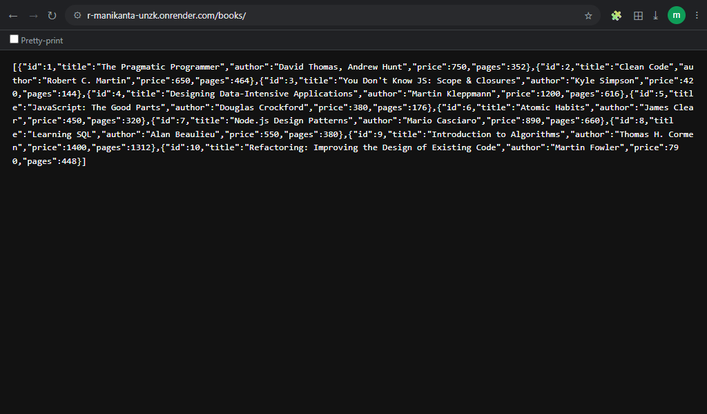

---

### 2. Search Query Parameter (`search_q=JavaScript`)
- **Live URL:** [https://r-manikanta-unzk.onrender.com/books/?search_q=JavaScript](https://r-manikanta-unzk.onrender.com/books/?search_q=JavaScript)
- **Expected HTTP Status:** `200 OK`

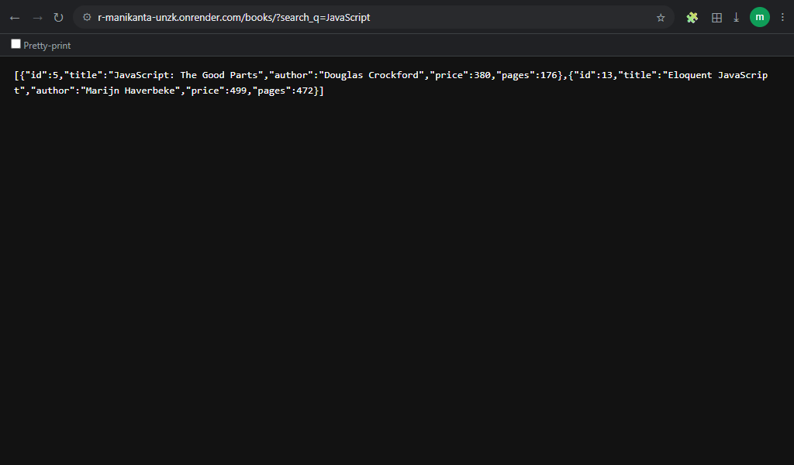

---

### 3. Sorting (`order_by=price&order=DESC`)
- **Live URL:** [https://r-manikanta-unzk.onrender.com/books/?order_by=price&order=DESC](https://r-manikanta-unzk.onrender.com/books/?order_by=price&order=DESC)
- **Expected HTTP Status:** `200 OK`

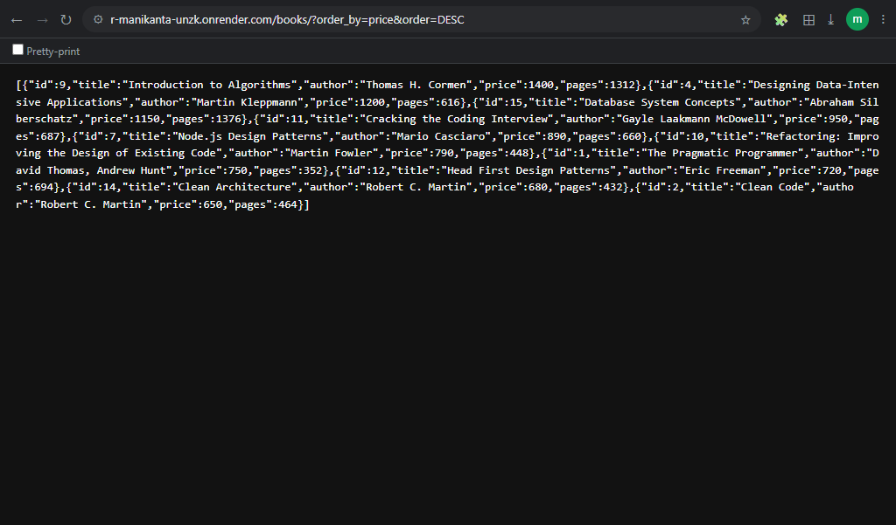

---

### 4. Pagination (`limit=3&offset=3`)
- **Live URL:** [https://r-manikanta-unzk.onrender.com/books/?limit=3&offset=3](https://r-manikanta-unzk.onrender.com/books/?limit=3&offset=3)
- **Expected HTTP Status:** `200 OK`

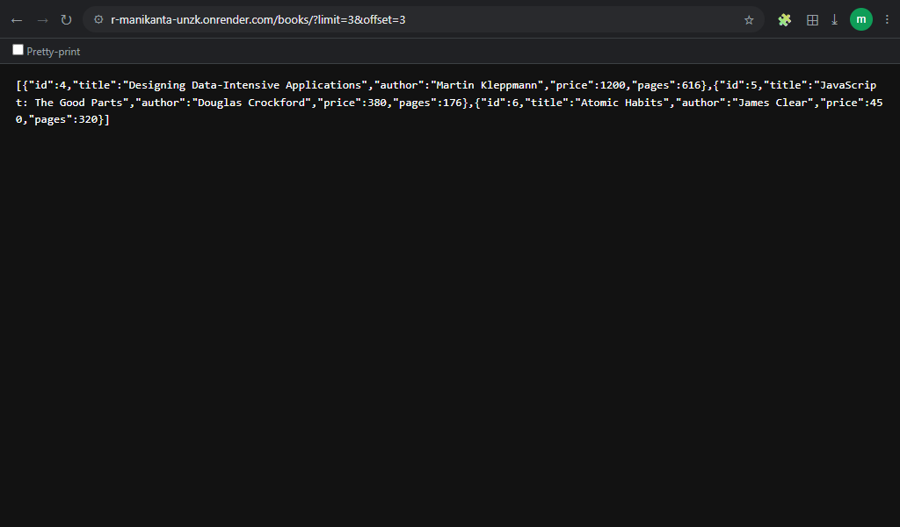

---

### 5. Price Range Filter (`min_price=400&max_price=800`)
- **Live URL:** [https://r-manikanta-unzk.onrender.com/books/?min_price=400&max_price=800](https://r-manikanta-unzk.onrender.com/books/?min_price=400&max_price=800)
- **Expected HTTP Status:** `200 OK`

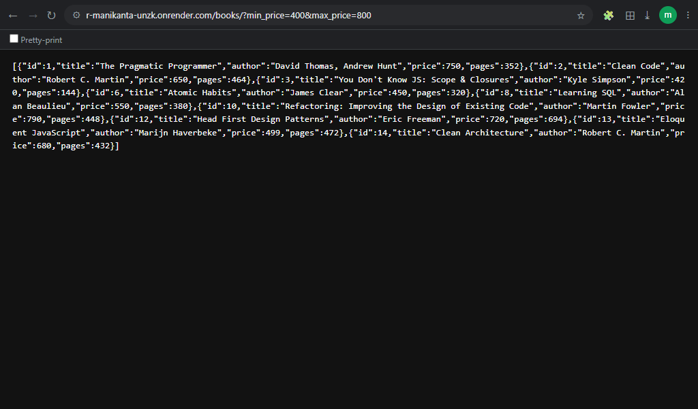

---

### 6. Combined Query Parameters
- **Live URL:** [https://r-manikanta-unzk.onrender.com/books/?search_q=the&min_price=200&max_price=900&order_by=price&order=DESC&limit=4&offset=0](https://r-manikanta-unzk.onrender.com/books/?search_q=the&min_price=200&max_price=900&order_by=price&order=DESC&limit=4&offset=0)
- **Expected HTTP Status:** `200 OK`

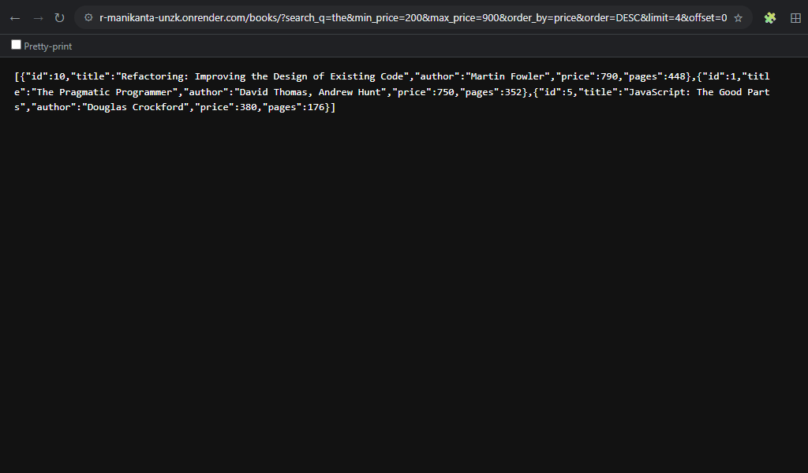

---

### 7. POST Create Book (201 Created)
- **Endpoint:** `POST /books/`
- **Expected HTTP Status:** `201 Created`

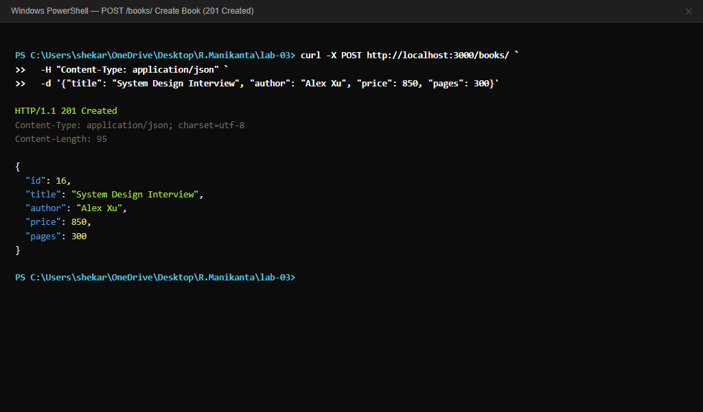

---

### 8. POST Validation Error (400 Bad Request)
- **Endpoint:** `POST /books/`
- **Expected HTTP Status:** `400 Bad Request`

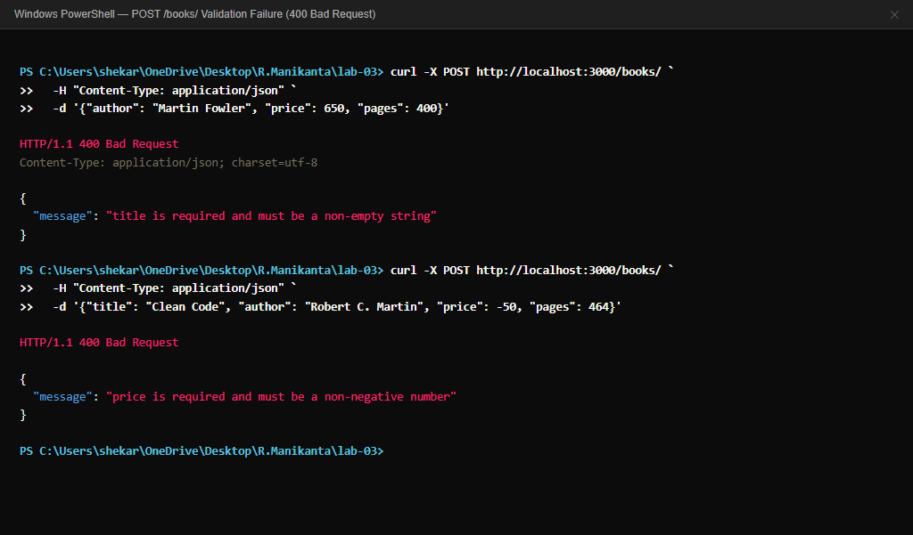

---

### 9. PUT Update Book (200 OK)
- **Endpoint:** `PUT /books/1/`
- **Expected HTTP Status:** `200 OK`

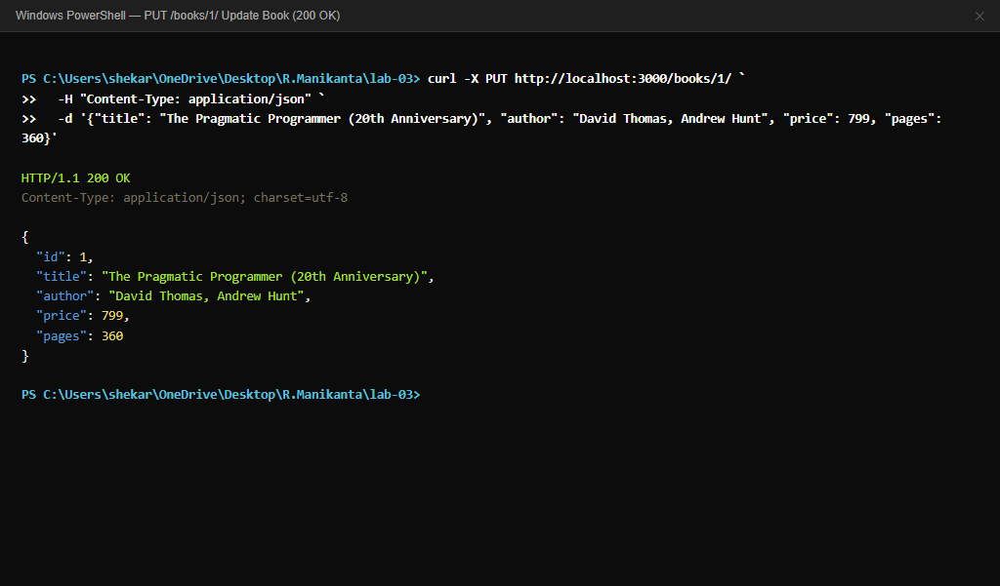

---

### 10. DELETE Book (200 OK)
- **Endpoint:** `DELETE /books/15/`
- **Expected HTTP Status:** `200 OK`

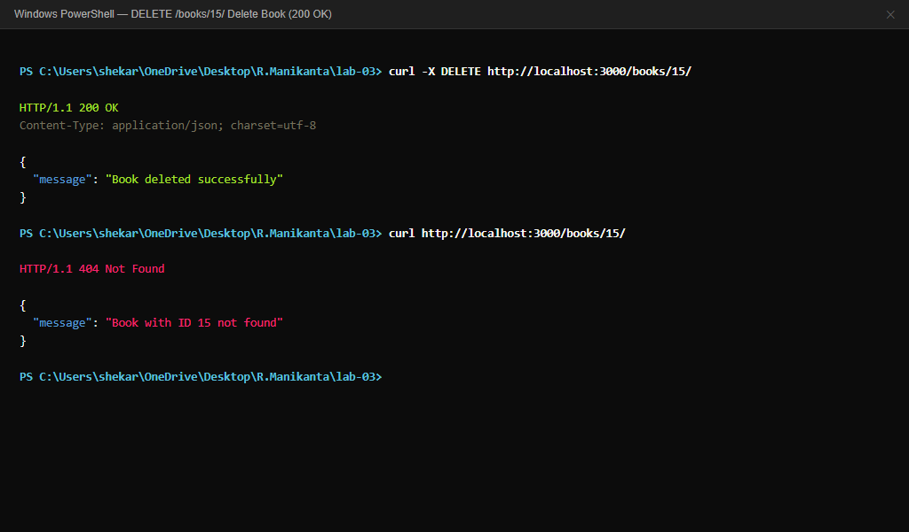

---

### 11. 404 Not Found for Non-Existent ID
- **Live URL:** [https://r-manikanta-unzk.onrender.com/books/999/](https://r-manikanta-unzk.onrender.com/books/999/)
- **Expected HTTP Status:** `404 Not Found`

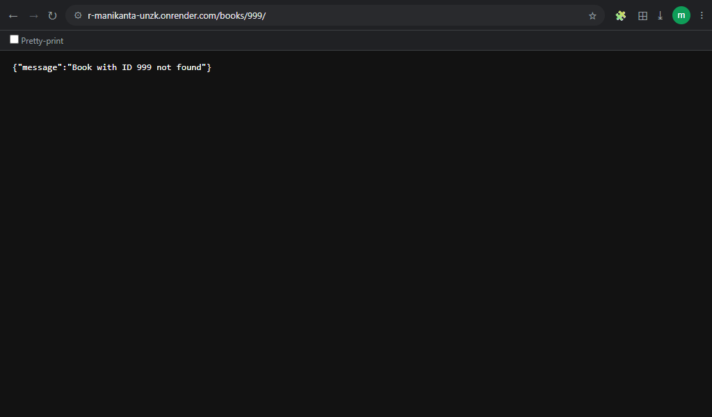

---

### 12. SQLite CLI Verification (Before & After Operations)
- **Tool:** SQLite CLI (`sqlite3 database.db`)
- **Commands:** `.headers on`, `.mode column`, `SELECT`

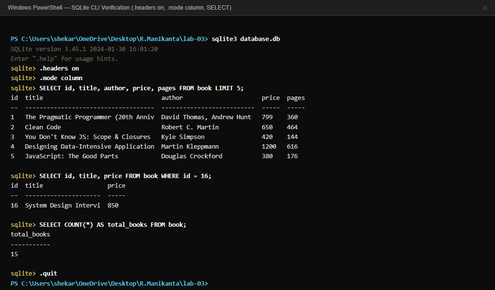

---

### 13. Debugging Bug 1: Port Conflict (`EADDRINUSE`)
- **Observed:** `Error: listen EADDRINUSE: address already in use :::3000`

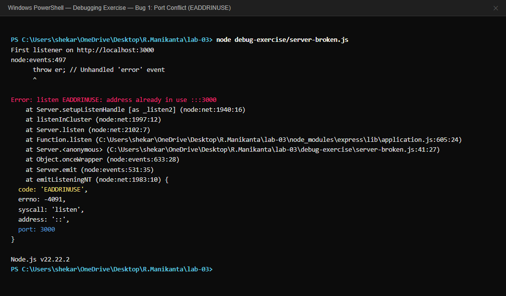

---

### 14. Debugging Bug 2: Wrong Import Path (`MODULE_NOT_FOUND`)
- **Observed:** `Error: Cannot find module './wrong-sqlite-path'`

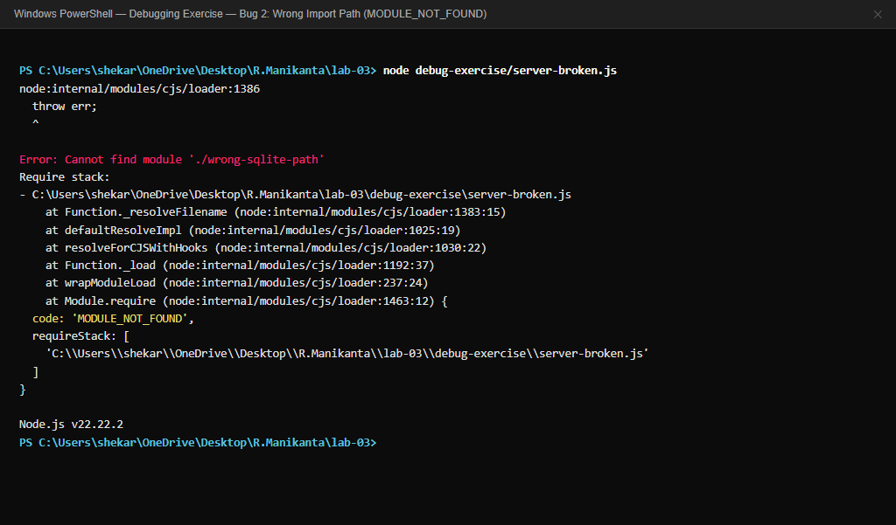

---

### 15. Debugging Bug 3: Table-Name Typo (`no such table: books`)
- **Observed:** `SQLITE_ERROR: no such table: books`

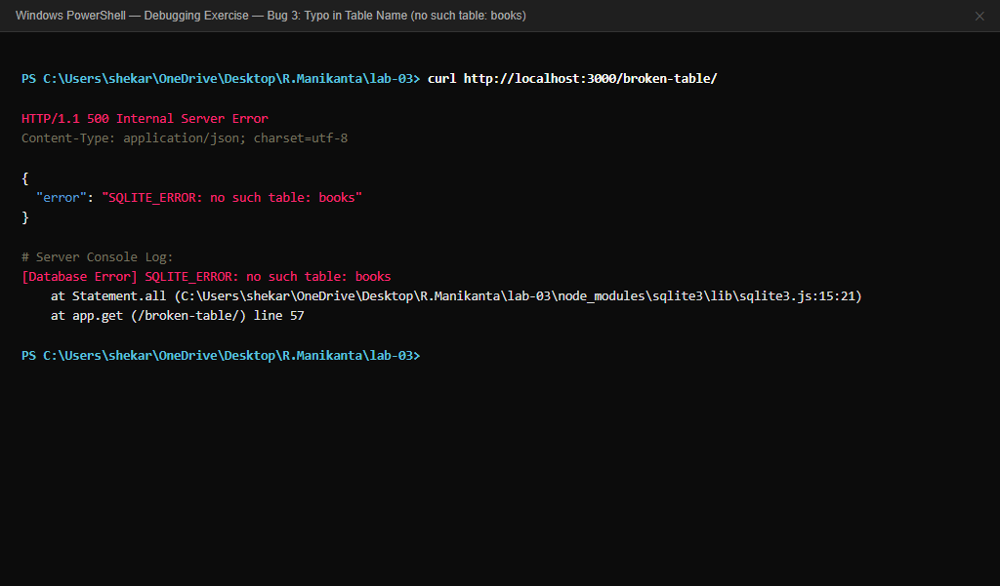

---

### 16. Debugging Bug 4: Missing `await` on Database Call
- **Observed:** Returned `Promise { <pending> }` resulting in empty JSON `{}`

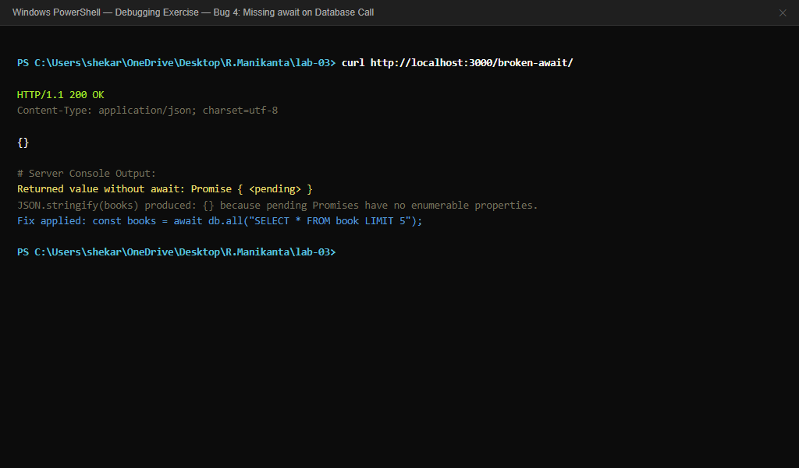

---

## 🛠️ Notes: Problems Faced and Solutions (Debugging Exercises)

During development and testing, four critical backend bugs were reproduced and resolved in the [`debug-exercise/`](debug-exercise/DEBUGGING.md) module:

1. **Bug 1: Port Conflict (`EADDRINUSE`)**
   - **Problem:** Attempting to start the Express server when another instance was already listening on port 3000 caused Node to crash with `listen EADDRINUSE :::3000`.
   - **Solution:** Configured `process.env.PORT || 3000` to allow dynamic port binding and attached an `error` listener on the HTTP server object (`server.on("error", ...)`) to display a user-friendly instruction instead of crashing unhandled.

2. **Bug 2: Wrong Import / Require Path (`MODULE_NOT_FOUND`)**
   - **Problem:** Writing `require("./wrong-sqlite-path")` caused the CommonJS loader to fail with `MODULE_NOT_FOUND` because no local file matched that path.
   - **Solution:** Replaced the local path with the installed package name `require("sqlite3")` and verified that the package exists in `package.json`.

3. **Bug 3: Table-Name Typo (`no such table: books`)**
   - **Problem:** The schema defined the table as `book` (singular), but an endpoint queried `SELECT * FROM books;` (plural), resulting in `SQLITE_ERROR: no such table: books` (HTTP 500).
   - **Solution:** Aligned all SQL queries to reference `book` consistently.

4. **Bug 4: Missing `await` on Database Calls**
   - **Problem:** Omitting `await` when calling `db.all("SELECT * FROM book")` caused the function to return a pending `Promise` object immediately. When Express serialized it with `JSON.stringify()`, it returned `{}` to the client with HTTP 200 without throwing an error.
   - **Solution:** Added `await` before asynchronous database queries inside `async` route handlers so execution pauses until SQLite resolves the array of records.

---

## 🎓 Viva Voce Notes & Practical Interview Questions

### 1. What is the difference between a Path Parameter and a Query Parameter?
- **Path Parameter (`req.params`):** Part of the URL path used to identify a **specific, unique resource**.
  - *Example:* `/books/1/` — `1` identifies the specific book with primary key 1.
- **Query Parameter (`req.query`):** Appended after a `?` in key-value pairs used to **filter, sort, search, or paginate** a collection.
  - *Example:* `/books/?order_by=price&order=DESC&limit=5` — sorts and limits the list without changing the identity of the resource collection.

### 2. What does "Stateless" mean in RESTful API architecture?
- Every HTTP request from a client to the server must contain **all the context and information** necessary for the server to understand and process the request.
- The server stores **no client session state** between requests. If request A succeeds and request B follows, request B cannot rely on memory from request A. This makes REST APIs horizontally scalable and resilient to server restarts.

### 3. What is the difference between HTTP Status Code 400 and 404?
- **HTTP 400 (Bad Request):** The client sent a request with invalid syntax, malformed data, or missing required fields (e.g. sending a negative price, missing author, or non-numeric ID). The client should modify the request payload before retrying.
- **HTTP 404 (Not Found):** The client request is syntactically well-formed, but the requested resource (URI or database ID) does not exist on the server (e.g. requesting `/books/999/`).

### 4. Why cannot SQL `ORDER BY` column names be parameterized with `?` placeholders?
- SQLite parameterized queries (`?`) are designed by the SQL engine strictly for **data literals** (numbers, strings, dates), not for SQL grammar identifiers (column names, table names, or keywords like `ASC`/`DESC`).
- If you write `ORDER BY ?` and pass `'price'`, SQLite treats it as ordering by a constant string `'price'`, not the column `price`, which has no sorting effect.
- **The Security Risk:** Developers often resort to string concatenation (`ORDER BY ${order_by}`), which opens the door to SQL Injection.
- **The Solution:** Whitelist allowed column names in JavaScript code:
  ```javascript
  const allowedColumns = ["id", "title", "author", "price", "pages"];
  if (!allowedColumns.includes(order_by)) {
    return res.status(400).json({ message: "Invalid order_by column" });
  }
  ```

### 5. Why do Parameterized Queries (`?`) prevent SQL Injection attacks?
- In parameterized queries, the SQL query structure and the user-supplied data are sent to the database engine in **two separate steps**.
- The database compiles and analyzes the query execution plan **before** binding the parameter values.
- The database driver treats any parameter bound to `?` strictly as a **passive data value**, never as executable SQL code. Even if a user enters `' OR 1=1; DROP TABLE book; --`, it is treated as a literal search string, making SQL injection impossible.

